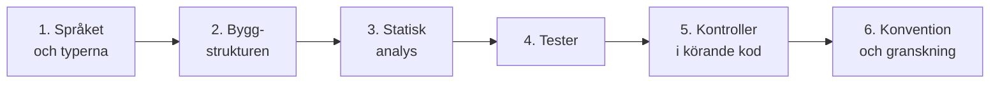
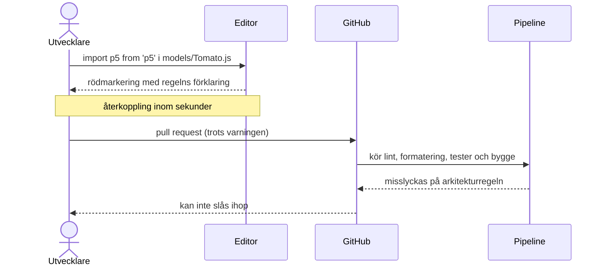
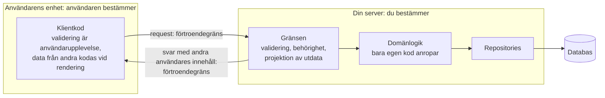

# Låt verktygen hålla reglerna

Den här texten handlar om var ett designbeslut ska upprätthållas. Ett beslut som "modellen får inte bero på vyn" kan stå i ett dokument, byggas in i koden som skydd som körs varje gång programmet körs, eller kontrolleras av ett verktyg innan koden ens har körts. Valet påverkar hur lätt koden är att läsa, vad den kostar att köra och om regeln faktiskt följs. Därför hör frågan hemma i en kurs om mjukvarukvalitet: en regel som ingen kontrollerar är en önskan, och ett skydd som gör koden svårare att läsa kan kosta mer än det ger.

Exemplen kommer från Ripe Tomato, där arkitekturen beskrivs i [MVC_DESIGN.md](MVC_DESIGN.md). Ett eget avsnitt visar varför slutsatserna beror på var förtroendegränserna går. Det jämför spelet med en Express-app, den MVC-variant som jämförs med spelloopen i [REFLECTION_SESSION_2.md](REFLECTION_SESSION_2.md), och prövar om det går att generalisera efter roll, frontend och backend. Avsnittet om andra språk visar att samma fråga får olika svar beroende på vad språket självt kan uttrycka.

## Problemet: regler som bara finns i ett dokument

En arkitektur består till stor del av regler om vad som får känna till vad. I Ripe Tomato är de viktigaste att modellen inte känner till p5, vyerna eller kontrollerna, och att vyerna läser modellen men aldrig ändrar den. Reglerna är lätta att formulera. De är också lätta att bryta, och det sker sällan på en gång. Någon importerar `p5` i modellen "bara för att få `p.constrain`", eller låter en vy anropa `game.restart()` för att en knapp ska fungera. Var och en av genvägarna verkar ofarlig. Tillsammans kallas resultatet *arkitekturerosion*: strukturen bryts ned så långsamt att ingen märker när den slutade gälla.

### Två reflexer som inte hjälper

Det finns två vanliga reaktioner på risken, och båda har brister.

Den första är att **lita på konvention**. Regeln skrivs ned och förväntas följas, och kodgranskningen ska fånga avstegen. Men granskningar blir inte alltid av, och när de blir av letar granskaren efter mycket annat. En import på rad tre i en fil med hundra rader är lätt att missa.

Den andra är att **bygga in skyddet i koden**. Om vyn inte ska kunna ändra modellen, får den en kopia i stället för modellen. Om ett objekt inte ska ändras, fryses det med `Object.freeze`. Det fungerar, men skyddet körs varje gång programmet körs, och det gör koden längre. I Ripe Tomato skulle det betyda att modellens tillstånd kopieras till nya objekt sextio gånger per sekund. Kostnaden i processortid är liten. Den stora kostnaden är underhållet: varje fält beskrivs nu på två ställen, i modellen och i kopian, och de två måste hållas i takt med varandra.

Det finns ett tredje alternativ: att låta ett verktyg kontrollera regeln.

## Var en regel kan kontrolleras

En regel kan kontrolleras på flera nivåer. De skiljer sig åt i när felet upptäcks och vad kontrollen kostar.



| Nivå | Felet upptäcks | Kostar när programmet körs | Exempel |
| --- | --- | --- | --- |
| 1. Språket och typerna | när koden skrivs eller kompileras | nej | `readonly` i TypeScript, `&T` i Rust |
| 2. Byggstrukturen | när koden byggs | nej | moduler som inte exporterar allt, förbud mot cykler mellan projekt |
| 3. Statisk analys | när koden skrivs, i editorn | nej | ESLint-regler per mapp, arkitekturtester |
| 4. Tester | när testerna körs | nej | ett test som spelar igenom en bana |
| 5. Kontroller i körande kod | när koden körs | ja, varje gång | validering, defensiva kopior, `Object.freeze` |
| 6. Konvention och granskning | om någon ser det | nej | en regel i ett dokument |

Tumregeln är att lägga kontrollen så tidigt i kedjan som språket och verktygen tillåter. Ju tidigare nivå, desto snabbare återkoppling och desto mindre kod som körs i onödan. Nivå 6 behövs alltid, men för det som verktyg inte kan se: om namnen är bra, om ansvaret ligger rätt och om designen håller för nästa krav.

Vilka nivåer som finns att välja på beror på språket. JavaScript har nästan ingenting på nivå 1 och 2, och det förklarar varför frestelsen att skriva defensiv kod är så stor just där.

## Exemplet Ripe Tomato

### Får vyn ändra modellen?

`Game` lämnar ut sina objekt som referenser. `GameView` får tillgång till `game.tomato` för att kunna rita tomaten, och därmed kan den tekniskt sett anropa `game.tomato.jump()`. Det är den sortens läcka som brukar kallas *privacy leak*. Fem sätt att hantera den diskuterades:

| Alternativ | Nivå | Skyddar | Kostar |
| --- | --- | --- | --- |
| Kopior (DTO:er) av modellens tillstånd varje frame | 5 | helt | en andra beskrivning av varje form, mappningskod, nya objekt varje frame |
| `Object.freeze` eller en skrivskyddad `Proxy` | 5 | helt, men först när koden körs | körtid, och fel som upptäcks sent |
| Destrukturering i vyernas parametrar, `draw({ x, y, radius })` | 1–3 | lövvyerna, eftersom de bara får värden | lite, men `GameView` har fortfarande `game` |
| Ett eget ESLint-plugin som förstår typer | 3 | nästan helt | ett eget paket med regelkod och tester att underhålla |
| En `no-restricted-syntax`-regel i den befintliga konfigurationen | 3 | anrop av modellens kommandon från vyer, matchade på namn | några rader konfiguration |

Valet blev det sista alternativet. Det ger inte ett fullständigt skydd. Regeln matchar metodnamn och inte typer, så listan måste hållas i takt med kommandona i `Game`. Men felet den skyddar mot är ovanligt och lätt att se, och regeln kostar nästan ingenting. Arkitekturen ska kosta i proportion till den risk den tar bort, och det gäller även verktygen.

```js
{
  files: ['src/js/views/**/*.js'],
  rules: {
    // Imports can't tell reading the model from changing it, so calls to Game's commands are
    // matched by name. Keep the list in sync with the commands Game exposes.
    'no-restricted-syntax': [
      'error',
      {
        selector:
          "CallExpression > MemberExpression.callee[property.type='Identifier'][property.name=/^(jump|steer|restart|update)$/]",
        message: 'Views only read the model. Commands are sent by the controller, and time is advanced by the loop.',
      },
    ],
  },
},
```

Selektorn är en AST-selektor, ungefär som CSS för syntaxträdet. Den matchar ett anrop vars mottagare är ett objekt och vars metodnamn är ett av modellens kommandon. `this.#game.jump()` fångas, medan `this.#camera.follow(...)` och privata metoder som `this.#jump()` passerar.

### Beroenderiktningen

Den viktigaste regeln i Ripe Tomato är att modellen inte beror på något utanför sig själv. Den kontrolleras med ESLints inbyggda `no-restricted-imports`, avgränsad till filerna i `models/`:

```js
{
  files: ['src/js/models/**/*.js'],
  rules: {
    'no-restricted-imports': [
      'error',
      {
        patterns: [
          {
            group: ['p5', '**/views/**', '**/controllers/**', '**/index.js'],
            message: 'The model must run without the interface (and in Node, e.g. to verify a score on a server).',
          },
        ],
      },
    ],
  },
},
```

Två detaljer gör regeln användbar. Mönstren är i gitignore-stil och fångar därför både alias-importer (`@/views/GameView.js`) och relativa sökvägar (`../views/GameView.js`). Felmeddelandet förklarar dessutom *varför* regeln finns. När någon bryter mot den får de skälet direkt i editorn, där det behövs, i stället för i ett dokument de kanske aldrig läser.

Samma idé går längre än importer. `no-restricted-globals` förbjuder `window`, `document` och `fetch` i modellen, och `no-restricted-properties` förbjuder `Math.random` och `Date.now`. Det håller modellen fri från webbläsaren, så att den kan köras i Node, och fri från dolda källor till tid och slump, så att den beter sig likadant varje gång. Ingen av reglerna kostar något när spelet körs.

### Pipelinen gör regeln bindande

En linter som bara körs lokalt är en hjälp, inte ett krav. Den som inte kör `npm run lint` märker ingenting. Därför körs samma kontroller i en pipeline, `.github/workflows/ci.yml`, vid varje pull request.



Det sista steget, att pull requesten inte kan slås ihop, kräver en inställning i GitHub: jobbet måste göras till en obligatorisk statuskontroll i *branch protection* för `main`. Först då är regeln bindande. Den gäller också när ingen granskar.

Det betyder inte att granskningen blir onödig. Den *avlastas*. Det som kan uttryckas som en mekanisk regel kontrolleras varje gång och utan undantag av verktyget. Granskaren behöver inte leta efter den sortens fel och kan i stället ägna sig åt det verktyg inte ser.

## När kontroller i körande kod är rätt

Resonemanget ovan betyder inte att kontroller i körande kod alltid är fel. De är rätt i tre situationer.

**Vid förtroendegränser.** Indata från användare, filer och nätverk kan vara vad som helst, och ingen linter kan veta vad en användare skriver eller vad en server skickar. Sådant måste valideras när programmet körs. Om Ripe Tomato en dag hämtar banor från en server, ska JSON-datat valideras innan det blir domänobjekt.

**I bibliotek som andra använder.** En lintregel skyddar bara den kod den körs på. Den som använder ett bibliotek kör inte bibliotekets linter. Ett bibliotek behöver därför skydda sina invarianter med språkets egna medel, som `#private`, `Object.freeze` och validering av argument, i högre grad än en applikation där all kod är ens egen.

**När säkerhet står på spel.** En lintregel kan stängas av med en kommentar. Den är ett skydd mot misstag, aldrig mot någon som medvetet försöker kringgå den.

Ripe Tomato har exempel på båda sidor av gränsen. `Tomato`s konstruktor kontrollerar att argumenten är ändliga tal och kastar ett `TypeError` annars. Kontrollen körs en gång per objekt och fångar felet där det uppstår, i stället för som ett `NaN` som dyker upp långt senare i ritkoden. Det är billigt och ger mycket. `Game.update(dt)` kontrollerar på samma sätt att `dt` är ett giltigt tal, men den kontrollen körs varje frame, och den enda som anropar metoden är spelets egen loop. Kostnaden är försumbar, men den är svårare att motivera. Den hade kunnat ersättas med ett test av loopen.

## Sammanhanget avgör: var går gränsen?

Slutsatserna om Ripe Tomato gäller Ripe Tomato. Principen är allmän: kontrollera varje regel på den tidigaste nivå som faktiskt fungerar, och lägg kontroller i körande kod vid förtroendegränserna. Men var förtroendegränserna går beror på sammanhanget, och då kan samma princip ge motsatta svar.

För en webbprogrammerare ligger det nära till hands att dela upp frågan efter roll: frontendutvecklare kan lita på verktyg och typer, och backendutvecklare måste kontrollera allt när koden körs. Indelningen stämmer ofta, men den är ett ungefärligt mått på något annat. Den är dessutom extra vansklig på webben, där samma person ofta skriver både klient och server och där samma språk, JavaScript, körs på båda sidor. Det som avgör är tre frågor om själva koden:

1. **Vem kontrollerar miljön där koden körs?** Din egen server, eller en enhet som användaren bestämmer över?
2. **Var kommer datan ifrån?** Från din egen kod, eller utifrån: användare, nätverk, filer, tredje part?
3. **Vem anropar koden?** Bara din egen kod, eller andra: en biblioteksanvändare, en publik ändpunkt?

Svaren bestämmer var gränserna går. Bakom en gräns, där bara den egna koden når fram, räcker verktyg och typer. Vid gränsen behövs kontroller i körande kod. Det gäller oavsett om koden körs i webbläsaren eller på servern.



Bilden visar en vanlig webbapplikation med två gränser. Requesten in till servern är den välkända. Den andra går åt motsatt håll: när klienten visar innehåll som andra användare har skapat, är det data utifrån, även om den kommer från den egna servern. Ripe Tomato saknar båda, eftersom spelet varken skickar eller tar emot något.

I [REFLECTION_SESSION_2.md](REFLECTION_SESSION_2.md) jämförs MVC i en spelloop med MVC i en Express-app som renderar HTML på servern. De två ligger i var sin ände av skalan, och avsnitten nedan börjar med dem.

### Ripe Tomato har nästan inga förtroendegränser

Spelet körs helt i webbläsaren. Den enda indatan är tangentbord och mus, och den kan bara bli några få kända avsikter. Det finns inga hemligheter och ingen data som tillhör någon annan.

Klienten tillhör dessutom användaren. Den som vill fuska kan öppna webbläsarens utvecklarverktyg och ändra hopphastigheten. Inget skydd i klientkoden kan stoppa det. Skydd i körande kod kan alltså bara skydda mot programmerarens egna misstag, och sådana misstag fångas billigare av verktyg. Därför blir slutsatsen för Ripe Tomato så tydlig. Det enda skydd som verkligen behövs, att en highscore inte är fuskad, måste ligga på en server.

### I en Express-app korsar varje request en förtroendegräns

En Express-app tar emot `req.body`, `req.params`, query-strängar och cookies från vem som helst. Då ändras flera av svaren:

| Fråga | Ripe Tomato | Express med serverrenderade vyer |
| --- | --- | --- |
| Förtroendegränser | nästan inga | varje request |
| Kontroller i körande kod | undantag | krav vid gränsen, till exempel med zod, joi eller express-validator |
| Vad en läcka betyder | en vy *kan* anropa `jump()`, vilket är ett designfel | ett modellobjekt med `passwordHash` skickas till klienten, vilket är ett säkerhetsfel |
| DTO:er | en andra beskrivning av samma form, mest underhåll | en säkerhetsåtgärd, både för utdata och för indata |
| Kostnaden för kopior | sextio gånger per sekund, i en inre loop | en gång per request, försumbart jämfört med databasanropen |
| Vydata | vyn läser modellen direkt | `res.render(view, viewData)` bygger redan ett vydataobjekt, eftersom mallen är kortlivad |
| Fler lager | inte motiverat, eftersom spelet saknar I/O | ofta motiverat, eftersom databas och I/O finns från början |
| Klocka och slump injiceras i modellen | för determinism och uppspelning | främst för testbarhet |

### En DTO är ett designval i spelet men ett säkerhetskrav på servern

Det är den viktigaste skillnaden. I Ripe Tomato valdes DTO:er bort, och det var rätt där. Men den som drar slutsatsen att DTO:er i allmänhet är onödiga, och sedan skickar modellobjekt rakt ut från en Express-app, har lärt sig fel sak:

```js
// Sends every field of the document to the client, including passwordHash.
res.json(await User.findById(req.params.id))

// Sends exactly the fields the client may see.
const user = await User.findById(req.params.id)
res.json({ id: user.id, name: user.name })
```

Samma sak gäller åt andra hållet. `User.create(req.body)` låter klienten sätta vilket fält som helst, till exempel `isAdmin`. Det kallas *mass assignment*. Indata ska valideras och plockas fält för fält innan den når modellen. OWASP räknar båda felen, för mycket data ut och okontrollerad data in, till samma risk bland de vanligaste API-riskerna: *API3:2023 Broken Object Property Level Authorization*.

Ingen linter kan avgöra vilka fält som är känsliga. Här är en kontroll i körande kod, i form av en explicit projektion eller ett valideringsschema, rätt nivå.

### Mallmotorn är en kontroll på nivå 1

I en Express-app är vyerna ofta mallar och inte JavaScript, och ESLint kontrollerar dem inte. Då blir valet av mallmotor en arkitekturfråga. En logikfattig mallmotor som Handlebars upprätthåller regeln "vyn läser bara" genom själva språket: mallen kan visa värden, iterera och anropa registrerade hjälpfunktioner, men inte köra godtycklig kod. Sedan version 4.6 blockerar Handlebars dessutom åtkomst till egenskaper på objektens prototyp som standard. EJS tillåter däremot godtycklig JavaScript i mallen, och då vilar regeln återigen på konvention. Det är samma resonemang som i språkjämförelsen nedan, tillämpat på mallspråk: ju mer språket kan uttrycka, desto mindre behöver kontrolleras på annat sätt.

### Det som inte ändras

Beroenderegeln och tekniken för att kontrollera den är desamma. I en Express-app ska modellen inte känna till HTTP, och det kontrolleras med samma regel som i Ripe Tomato:

```js
{
  files: ['src/models/**/*.js'],
  rules: {
    'no-restricted-imports': [
      'error',
      {
        patterns: [
          {
            group: ['express', '**/controllers/**', '**/routes/**', '**/views/**'],
            message: 'The model must not know about HTTP. Controllers translate requests into model calls.',
          },
        ],
      },
    ],
  },
},
```

Arbetsfördelningen mellan verktyg och granskning är också densamma. Skillnaden är att en Express-app har fler regler som *inte* kan kontrolleras av verktyg, eftersom de handlar om vilken data som är känslig och vem som får se den. Det gör granskningen viktigare där, inte mindre viktig.

### Frontend har också förtroendegränser

Ripe Tomato är ett extremfall: ingen data utifrån, en enda författare och ingenting att skydda. En vanlig webbklient visar kommentarer, profiler och meddelanden som andra användare har skrivit. Den som drar slutsatsen att klientkod saknar förtroendegränser skriver lätt så här:

```js
// Renders the comment as HTML. A comment containing  runs
// its code in the browser of everyone who reads it.
commentElement.innerHTML = comment.text

// Renders the comment as text. The browser never interprets it as HTML.
commentElement.textContent = comment.text
```

Det första exemplet är en XSS-sårbarhet (*cross-site scripting*). Det är samma sorts gräns som `req.body` på servern, fast åt andra hållet: data utifrån når en plats där den kan tolkas som kod. Andra gränser i klienten är parametrar i URL:en, meddelanden via `postMessage` (där avsändarens `event.origin` måste kontrolleras), `localStorage` som användaren kan ändra fritt, och skript från tredje part.

Även här hjälper verktygen till, men på ett annat sätt. Ramverk som React kodar text automatiskt, och det osäkra alternativet heter `dangerouslySetInnerHTML`. Namnet gör risken synlig i koden. En lintregel som Mozillas `eslint-plugin-no-unsanitized` pekar ut varje `innerHTML` med dynamiskt innehåll. En *Content Security Policy* är en inställning och inte kod, och den begränsar vilka skript webbläsaren över huvud taget kör. Verktygen kan alltså visa *var* en kontroll i körande kod behövs, men själva kodningen av datan sker när programmet körs.

### Det mesta av backend ligger bakom gränsen

Motsatsen gäller också. När en request väl har validerats och behörigheten är kontrollerad, är domänlogiken i samma läge som modellen i Ripe Tomato: bara den egna koden anropar den. Där är DTO:er mellan varje internt lager, defensiva kopior och en kontroll av varje argument i varje metod ren ceremoni. Lintregler, typer och tester räcker även där.

Ett användbart sätt att tänka kallas *parse, don't validate*. Datan kontrolleras en gång, vid gränsen, och översätts där till domänobjekt som bara kan finnas i giltigt skick. Konstruktorn i `Tomato` som avvisar `NaN` är ett litet exempel. Innanför gränsen behöver koden sedan inte fråga igen.

### När gränsen går mitt i kodbasen

I ramverk som Next.js, Remix och SvelteKit ligger klientkod och serverkod i samma kodbas, ibland i samma fil. Då syns gränsen inte längre i katalogstrukturen:

```js
'use server'

// Called from a component like an ordinary function, but it is an HTTP endpoint that
// anyone can call with any arguments. It needs the same checks as an Express route.
export async function deleteComment(commentId) {
  const user = await getCurrentUser()
  const comment = await Comment.findById(commentId)
  if (!user || comment.authorId !== user.id) {
    throw new Error('Not allowed.')
  }
  await comment.deleteOne()
}
```

Det som ser ut som ett funktionsanrop inom programmet är i själva verket en förtroendegräns. Risken finns också åt andra hållet: om en klientkomponent importerar en modul som läser hemliga nycklar, kan nycklarna hamna i den kod som skickas till webbläsaren. Den risken stoppas med ett verktyg. En modul som börjar med `import 'server-only'` får bygget att misslyckas om den importeras i klientkod. Det är den här textens resonemang i miniatyr: gränsen har säkerhetskonsekvenser, men den upprätthålls tidigast och billigast av byggverktyget.

### Kontroller som bara körs under utveckling

Det finns ett mellanläge mellan verktyg och kontroller i körande kod: kontroller som bara finns i utvecklingsbygget. Redux Toolkit upptäcker otillåtna ändringar av tillståndet, men bara under utveckling. React StrictMode renderar komponenter två gånger för att hitta oavsiktliga sidoeffekter, också bara under utveckling. Kontrollerna fångar den egna kodens misstag, och priset betalas aldrig i produktion.

Det tydliggör principen. Ett skydd mot de egna misstagen hör inte hemma i produktionskoden, men ett skydd mot omvärlden gör det. Kontrollen av `dt` i `Game.update` i Ripe Tomato är ett skydd mot egna misstag. Om den ska finnas kvar, hör den hemma i ett test eller bakom Vites `import.meta.env.DEV`.

### Samma språk på båda sidor

Webben är ovanlig på en punkt: JavaScript körs både i webbläsaren och i Node. En modul kan importeras på båda sidor, och koden ser likadan ut oavsett var den körs. Det är praktiskt, men det gör det lätt att glömma på vilken sida av gränsen en rad faktiskt körs.

Ett valideringsschema som delas mellan klient och server visar skillnaden tydligt. Det är samma kod, men den har två helt olika syften:

```js
// shared/commentSchema.js: imported by both the client and the server.
import { z } from 'zod'

export const commentSchema = z.object({
  text: z.string().min(1).max(2000),
})
```

```js
// Client: gives the user immediate feedback. It protects nothing, since anyone can
// send a request without going through the client.
const result = commentSchema.safeParse({ text: textarea.value })
if (!result.success) {
  showError(result.error)
}
```

```js
// Server: the actual protection. This is where the trust boundary is.
app.post('/comments', async (req, res) => {
  const { text } = commentSchema.parse(req.body)
  // ...
})
```

Att schemat delas är ett bra val, eftersom reglerna bara beskrivs på ett ställe. Men kontrollen i klienten är användarupplevelse och kontrollen på servern är säkerhet. Om kontrollen på servern tas bort "eftersom klienten redan validerar", finns inget skydd kvar.

### Gränserna i vanliga webbarkitekturer

Var gränserna går beror på hur applikationen är byggd. För de vanligaste webbarkitekturerna ser det ut så här:

| Arkitektur | Gränser | Vad det betyder i praktiken |
| --- | --- | --- |
| Statisk sida eller spel som bara körs i klienten, som Ripe Tomato | inga, så länge ingen data hämtas utifrån | verktyg och typer räcker. Inget skydd i klienten kan stoppa användaren |
| Serverrenderad app, som Express med Handlebars | requesten in till servern | validering, behörighet och projektion av data vid routen. Mallmotorn avgör hur mycket vyn kan göra |
| SPA mot ett REST-API, som React eller Vue med Express | requesten in till API:t, och renderingen av data från API:t i klienten | API:t är gränsen för säkerhet, och klienten måste koda data från andra användare. Validering i klienten är användarupplevelse |
| Ramverk som blandar klient och server, som Next.js, Remix eller SvelteKit | varje serverfunktion som klienten kan anropa, och varje import som kan dra med serverkod till klienten | gränsen syns inte i katalogstrukturen. Verktyg som `server-only` och lintregler gör den synlig |

Tabellen visar att samma webbprogrammerare kan arbeta på båda sidor av en gräns under en och samma dag. En regel som "frontendkod behöver inga kontroller" eller "backendkod ska validera allt" hjälper då inte. Frågan måste ställas om varje del av koden.

### Frontend och backend är en ungefärlig indelning

Indelningen efter roll stämmer för det mesta, eftersom klientkod oftast körs på användarens enhet och serverkod oftast tar emot requests. Men den leder till två typiska misstag, ett från vardera hållet:

| Misstag | Typiskt för | Följd | Rätt fråga |
| --- | --- | --- | --- |
| "Validering i klienten skyddar servern" | frontend, och den som delar ett schema och tar bort kontrollen på servern | vem som helst kan skicka en request utan att gå via klienten | vem kontrollerar miljön? |
| "Klientkod har inga förtroendegränser" | frontend | XSS när innehåll från andra renderas som HTML | var kommer datan ifrån? |
| "Varje lager ska validera och kopiera" | backend | ceremoni och dubbelarbete i kod som bara den egna koden anropar | vem anropar koden? |
| "Det här är bara ett funktionsanrop" | båda, med ramverk som blandar klient och server | en publik ändpunkt utan validering eller behörighetskontroll | vem anropar koden? |

Slutsatsen är att rätt svar följer gränserna och inte rollen. Bakom en gräns gäller samma villkor som i Ripe Tomato, oavsett om koden körs i webbläsaren eller på servern. Vid en gräns gäller det som gäller för Express, även i en React-komponent. Ripe Tomato är därför inte representativt för frontend i allmänhet. Det är det renaste fallet, där all kod ligger bakom en gräns, och därför blev slutsatserna så entydiga.

## Språken gör olika mycket av jobbet

Hur mycket som behöver kontrolleras av verktyg beror på hur mycket språket självt kan uttrycka. Nedan visas samma två regler i några olika språk: att modellen inte får bero på vyn, och att vyn inte får ändra det den läser.

### JavaScript

JavaScript har nästan ingenting på nivå 1 och 2. Privata fält (`#x`) och `Object.freeze` kontrolleras först när koden körs, och modulsystemet låter vilken fil som helst importera vilken annan fil som helst. Därför blir verktygen viktigare än i de flesta andra språk: ESLint för regler per mapp, och JSDoc med `checkJs` för typkontroll i editorn.

För regler som omfattar hela beroendegrafen, till exempel ett förbud mot cykler, finns `dependency-cruiser`. Regler skrivs med reguljära uttryck för sökvägar:

```js
// .dependency-cruiser.cjs
module.exports = {
  forbidden: [
    {
      name: 'model-depends-on-nothing',
      severity: 'error',
      from: { path: '^src/js/models' },
      to: { path: '^src/js/(views|controllers)' },
    },
  ],
}
```

Verktyget kan också rita beroendegrafen. Då syns arkitekturen som den faktiskt är och inte som man tror att den är.

### TypeScript

TypeScript flyttar mycket av ansvaret till nivå 1. Typerna försvinner vid kompileringen, så de kostar ingenting när programmet körs. Läckan i Ripe Tomato löses utan kopior genom att modellen lämnar ut sitt objekt med en skrivskyddad typ:

```ts
interface TomatoState {
  readonly x: number
  readonly y: number
  readonly radius: number
}

class Game {
  #tomato = new Tomato(1)

  // The view sees only the state. jump() isn't part of the type.
  get tomato(): TomatoState {
    return this.#tomato
  }
}
```

Det är samma referens som förut, men kompilatorn vägrar `game.tomato.jump()`. Skyddet går att kringgå med `as any`, så det är ett skydd mot misstag, precis som lintregeln. Beroenderiktningen kontrolleras däremot inte av typsystemet, så i TypeScript behövs ESLint eller `dependency-cruiser` för den, precis som i JavaScript.

### Java och C#

I Java och C# bär språket och byggsystemet mycket. Åtkomstmodifierare som `package-private` i Java och `internal` i C# döljer klasser utanför sitt paket eller sin assembly. Javas modulsystem exporterar bara de paket som anges i `module-info.java`, och både Java-moduler och C#-projekt kan inte bero på varandra i cykler. Den som delar upp ett C#-program i projekt för modell och vy kan inte låta modellprojektet referera till vyprojektet om vyprojektet redan refererar till modellprojektet. Beroenderiktningen följer då av projektstrukturen.

Det som strukturen inte täcker kontrolleras med *arkitekturtester*, som skrivs som vanliga enhetstester. I Java är ArchUnit vanligast:

```java
@ArchTest
static final ArchRule modelDependsOnNothing =
    noClasses().that().resideInAPackage("..model..")
        .should().dependOnClassesThat().resideInAPackage("..view..");
```

I .NET finns NetArchTest med ett liknande gränssnitt:

```csharp
var result = Types.InAssembly(typeof(Game).Assembly)
    .That()
    .ResideInNamespace("RipeTomato.Models")
    .ShouldNot()
    .HaveDependencyOn("RipeTomato.Views")
    .GetResult()
    .IsSuccessful;
```

Arkitekturtester är etablerad praxis i båda språken. De ger samma sorts kontroll som lintreglerna i Ripe Tomato, men de körs med testerna och syns inte direkt i editorn.

### Python

Python har en uttalad kultur av konvention: ett understreck (`_x`) betyder "privat", men ingenting hindrar någon från att använda fältet. Uttrycket som brukar användas är *"we're all consenting adults"*. Därför ligger kontrollen nästan helt hos verktygen. `mypy` kontrollerar typer, och `import-linter` kontrollerar beroenden med kontrakt i en konfigurationsfil:

```ini
[importlinter]
root_package = ripe_tomato

[importlinter:contract:model]
name = The model must not import the view
type = forbidden
source_modules = ripe_tomato.models
forbidden_modules = ripe_tomato.views
```

Det finns även en kontraktstyp för lager, där tillåten beroenderiktning anges för en hel kedja av moduler i ett svep.

### Go

Go låter kompilatorn bära en del av beroenderiktningen. Importcykler är ett kompileringsfel, så om vyn importerar modellen kan modellen inte importera vyn. Paket i en katalog som heter `internal/` kan bara importeras av kod i delträdet under katalogen ovanför `internal/`, vilket ger paketsynlighet av det slag som JavaScript saknar. Kulturen i Go föredrar dessutom enkel och direkt kod framför skyddande konstruktioner, och verktyg som `go vet` och `staticcheck` tar resten.

### Rust

Rust löser läckan i typsystemet. En referens `&Tomato` är skrivskyddad, och kompilatorn tillåter inga anrop av metoder som kräver `&mut self` genom den. Om vyn får `&Tomato` kan den alltså inte anropa `jump()`, och det kostar ingenting när programmet körs. Det enda undantaget är typer som uttryckligen tillåter ändring genom en delad referens (*interior mutability*, som `Cell` och `RefCell`), och de syns i typen. Synligheten mellan moduler styrs med `pub` och `pub(crate)`, och ett program kan delas upp i flera crates med en beroenderiktning som `cargo` upprätthåller.

### Sammanställning

| Språk | Språket och bygget bär | Verktygen bär | Läckan i Ripe Tomato |
| --- | --- | --- | --- |
| JavaScript | nästan inget | ESLint, `checkJs`, `dependency-cruiser` | konvention plus lintregel |
| TypeScript | skrivskyddade typer | beroenderiktningen | löses i typen |
| Java, C# | synlighet, moduler, inga cykler mellan projekt | ArchUnit, NetArchTest | löses med interface eller oföränderliga typer |
| Python | nästan inget | `mypy`, `import-linter` | konvention plus verktyg |
| Go | inga importcykler, `internal/` | `go vet`, `staticcheck` | konvention |
| Rust | skrivskyddade referenser, synlighet, crates | Clippy | kan inte uppstå |

Mönstret är tydligt: ju mer språket kan uttrycka, desto mindre behövs både verktyg och skydd i körande kod. I JavaScript blir verktygen därför *viktigare*, inte mindre viktiga, eftersom det enda skydd språket erbjuder är det som kostar när programmet körs. Det är också ett argument för att använda JSDoc-typer och `checkJs` även i ett projekt som medvetet inte använder TypeScript.

## Gränserna

Verktyg ersätter inte omdöme, och de har egna kostnader.

- **Heuristiker ger falska larm och missar fel.** Regeln mot kommandoanrop i Ripe Tomato matchar på namn. En vy som av andra skäl anropar en metod som heter `update` får ett falskt larm, och ett nytt kommando i `Game` skyddas inte förrän någon lägger till det i listan.
- **Regler kan stängas av.** En `eslint-disable`-kommentar räcker. ESLint kan rapportera kommentarer som inte längre behövs (`--report-unused-disable-directives`), men själva avstängningen är synlig bara för den som läser koden.
- **Verktygskonfiguration är också kod.** Den ska läsas, förstås och underhållas. En regel för ett fel som aldrig inträffar är lika onödig som ett skydd i koden för samma fel.
- **Verktyg ser bara form, inte mening.** En linter kan se att modellen inte importerar vyn. Den kan inte se att en klass har fått fel ansvar, att ett namn är missvisande eller att en abstraktion inte håller.

Den sista punkten är skälet till att granskningen behövs även när alla mekaniska regler kontrolleras av verktyg. Skillnaden är att granskningen inte längre behöver lägga tid på det mekaniska.

## Sammanfattning

Ett designbeslut kan upprätthållas på flera nivåer: i språket, i byggstrukturen, med statisk analys, med tester, med kontroller i körande kod eller genom konvention. Ju tidigare nivå, desto snabbare återkoppling och desto mindre kod som körs i onödan. Kontroller i körande kod är rätt vid förtroendegränser, i bibliotek och när säkerhet står på spel, men inte som ett allmänt skydd mot den egna kodens misstag. Var förtroendegränserna går beror på sammanhanget, och det avgörs av tre frågor: vem som kontrollerar miljön, var datan kommer ifrån och vem som anropar koden. I ett spel som körs helt i klienten finns gränserna knappt, medan de i en Express-app finns vid varje request. Därför kan samma princip leda till att DTO:er väljs bort i det ena fallet och krävs i det andra. Indelningen i frontend och backend är ett ungefärligt mått på samma sak. Den stämmer ofta, men frontend har också gränser, och det mesta av backend ligger bakom gränsen. Hur mycket som behöver kontrolleras av verktyg beror slutligen på språket. I JavaScript, där språket ger minst hjälp, ger verktygen mest.

Tre kontrollfrågor fungerar oavsett språk och roll:

> Var går gränsen, och på vilken sida av den ligger koden?

> Kan regeln uttryckas så att ett verktyg kontrollerar den?

> Om skyddet måste finnas i körande kod: skyddar det mot något utanför min kontroll?

Bakom en gräns hör reglerna hemma i verktygen, om de kan uttryckas där. Vid en gräns behövs kontroller i körande kod, och där kan inget verktyg ersätta dem. Om svaret på den sista frågan är nej, är skyddet troligen onödigt.
