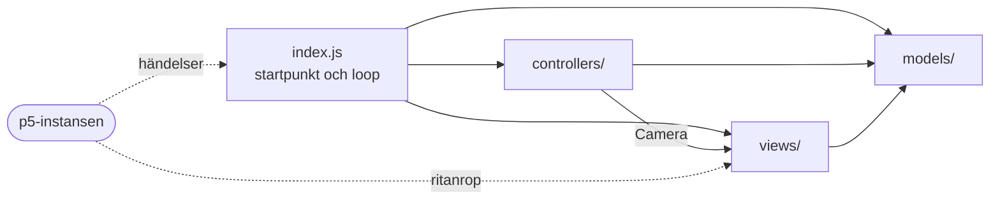
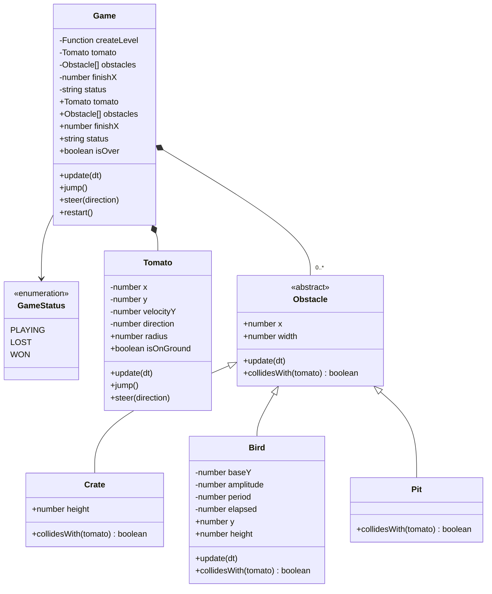
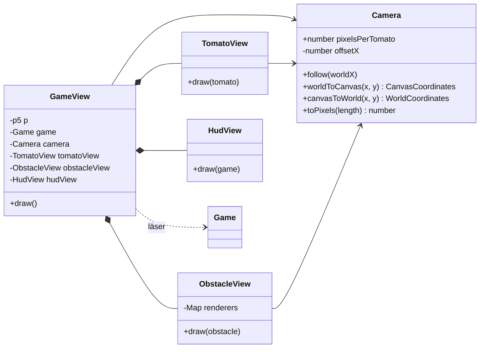
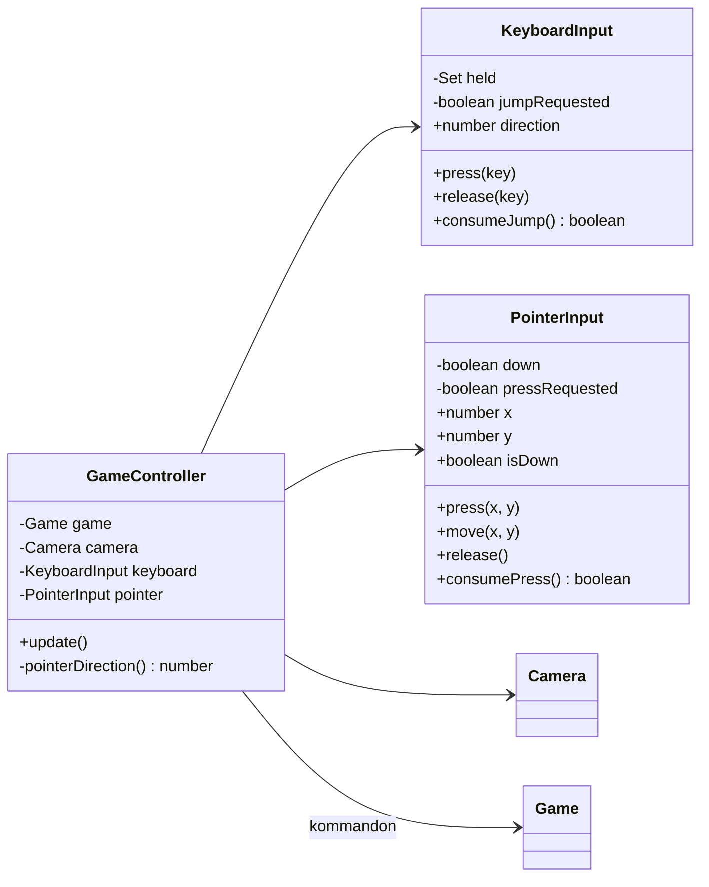
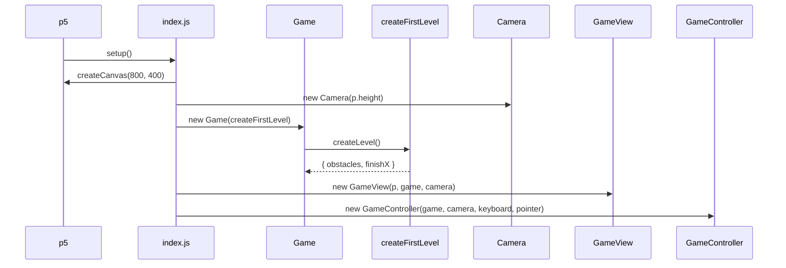
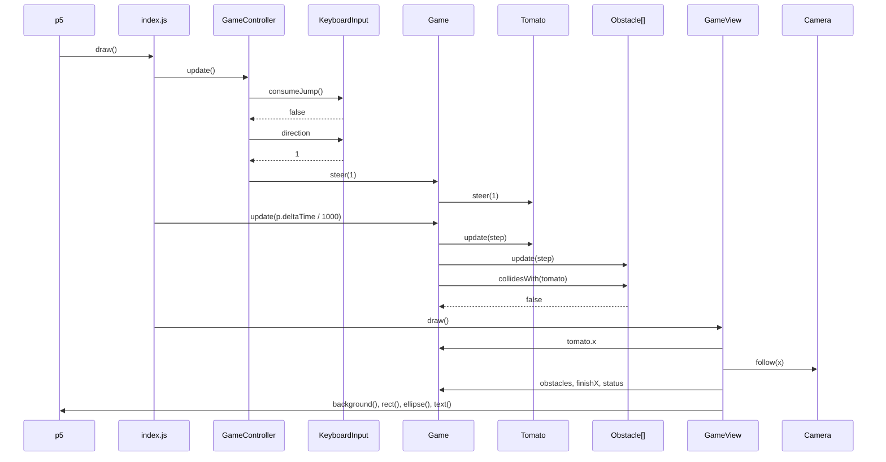
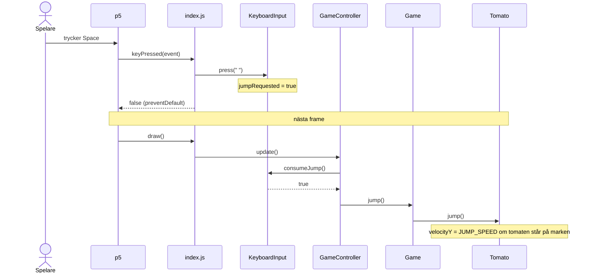
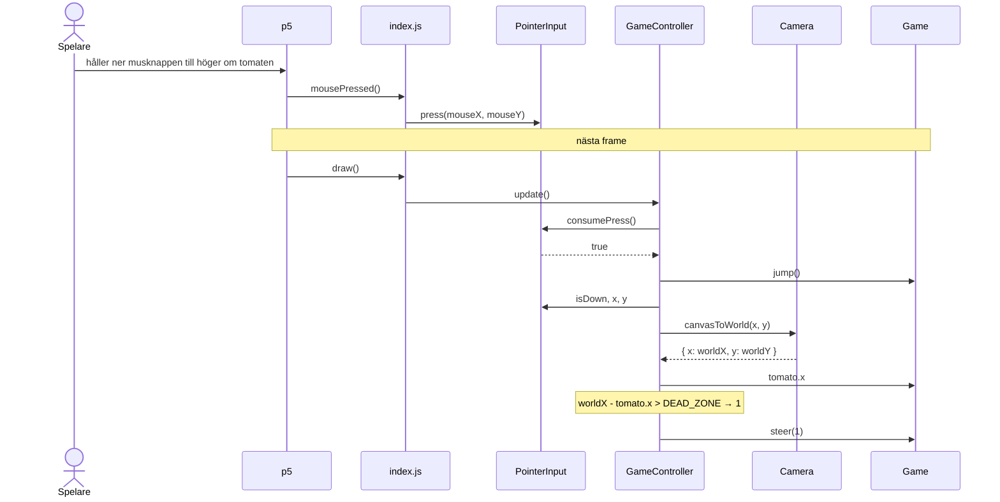
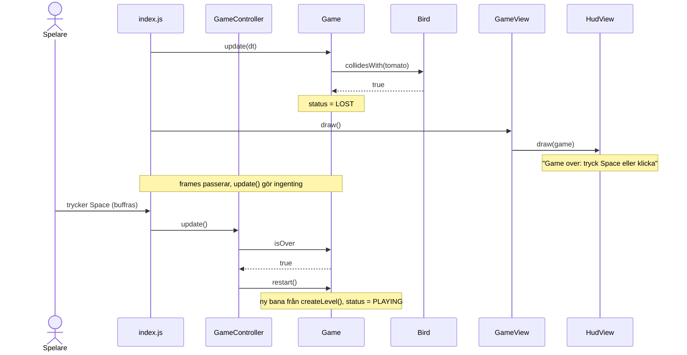

# Ripe Tomato: en MVC-design för en spelloop

Det här dokumentet beskriver en komplett MVC-arkitektur för Ripe Tomato. Den utgår inte från den kod som finns i dag, men avsnittet [Från nuvarande kod](#från-nuvarande-kod) visar vad som skiljer sig. Diskussionen om MVC i request/response jämfört med en spelloop finns i [REFLECTION_SESSION_2.md](REFLECTION_SESSION_2.md). Här är fokus i stället konkret: vilka klasser som finns, vad de ansvarar för, vad filerna heter och hur objekten samverkar under en frame.

## Krav

- En tomat ska kunna förflyttas framåt och undvika hinder av olika typer.
- Tomaten ska kunna styras med både tangentbord och mus.
- p5 används i *instance mode*, genom en instans som skapas i `index.js`.

Utöver det tillkommer några kvalitetskrav som följer av kursen:

- Modellen ska kunna köras och testas utan gränssnittet.
- Rörelser ska vara oberoende av bildfrekvensen.
- En ny hindertyp ska kunna läggas till utan att befintliga klasser behöver skrivas om.

## Översikt

Arkitekturen har tre roller och en startpunkt. Det finns inga fler lager än så. Det som bär designen är **beroenderiktningen**:



| Del | Får känna till | Får inte känna till |
| --- | --- | --- |
| `models/` | ingenting utanför `models/` | p5, pixlar, tangenter, musen |
| `views/` | modellen (läser), p5 | kontrollern |
| `controllers/` | modellen (kommandon), `Camera` | p5, ritning |
| `index.js` | allt | – |

Två regler gör separationen tydlig:

1. **Bara kontrollern ändrar modellen.** Vyn läser modellens tillstånd via getters men anropar aldrig kommandon som `jump()`.
2. **Bara `index.js` och vyerna ser p5.** Kontrollerns input-klasser tar emot vanliga värden (`'ArrowLeft'`, `x`, `y`), så de kan testas utan p5.

## Katalogstruktur och namn

```text
src/js/
├── index.js                  # startpunkt: skapar objekten, kopplar p5-händelser, kör loopen
├── models/
│   ├── Game.js               # fasad mot modellen: update(dt), jump(), steer(), restart()
│   ├── GameStatus.js         # uppräkning: PLAYING, LOST, WON
│   ├── Tomato.js             # spelkaraktären: position, hastighet, gravitation
│   ├── levels.js             # createFirstLevel() → { obstacles, finishX }
│   ├── geometry.js           # rena funktioner, t.ex. circleIntersectsRect()
│   └── obstacles/
│       ├── Obstacle.js       # abstrakt basklass
│       ├── Crate.js          # står still på marken, hoppa över
│       ├── Bird.js           # rör sig upp och ner, tajma passagen
│       └── Pit.js            # hål i marken, landa inte i det
├── views/
│   ├── Camera.js             # world space ↔ canvas space, följer tomaten
│   ├── GameView.js           # ritordning och sammansättning
│   ├── TomatoView.js
│   ├── ObstacleView.js       # en ritfunktion per hindertyp
│   └── HudView.js            # titel, framsteg, meddelanden
└── controllers/
    ├── GameController.js     # avsikter → modellkommandon
    ├── KeyboardInput.js      # buffrar tangentbordets tillstånd
    └── PointerInput.js       # buffrar musens tillstånd
```

Namnkonventionerna:

- **PascalCase för filer som exporterar en klass** (`Tomato.js`), **camelCase för moduler med funktioner** (`levels.js`, `geometry.js`).
- **Pluralis på rollmapparna** (`models/`, `views/`, `controllers/`), som i dag. En undermapp (`obstacles/`) införs när en roll får en grupp klasser som hör ihop.
- **Domännamn framför generiska namn.** `Tomato` i stället för `GameCharacter`: det finns bara en sorts karaktär, och "Game" i namnet säger inget som inte redan framgår av sammanhanget. Vyklasser heter som det de ritar, plus `View` (`TomatoView`).
- **Tester ligger bredvid koden de testar,** `Tomato.test.js` bredvid `Tomato.js`. Vitest är redan konfigurerat för `**/*.test.js`.

## Modellen

Modellen arbetar i **world space**: enheten är tomater, y-axeln pekar uppåt och marken ligger vid `y = 0`. Tid mäts i sekunder. Modellen vet inget om pixlar, tangenter eller p5.



### `Game`: fasaden

`Game` är modellens enda ingång för kontrollern. Den äger reglerna för hela spelet: när det är slut, vad som gäller vid kollision och när banan är klarad.

```js
export class Game {
  /** The longest step the simulation takes, in seconds. */
  static #MAX_TIME_STEP = 1 / 30

  #createLevel
  #tomato
  #obstacles
  #finishX
  #status

  /**
   * @param {() => { obstacles: Obstacle[], finishX: number }} createLevel
   */
  constructor(createLevel) {
    this.#createLevel = createLevel
    this.restart()
  }

  restart = () => {
    const { obstacles, finishX } = this.#createLevel()
    this.#tomato = new Tomato(0.5)
    this.#obstacles = obstacles
    this.#finishX = finishX
    this.#status = GameStatus.PLAYING
  }

  jump = () => {
    if (this.#status === GameStatus.PLAYING) this.#tomato.jump()
  }

  steer = (direction) => {
    if (this.#status === GameStatus.PLAYING) this.#tomato.steer(direction)
  }

  update = (dt) => {
    if (this.#status !== GameStatus.PLAYING) return

    const step = Math.min(dt, Game.#MAX_TIME_STEP)
    this.#tomato.update(step)
    this.#obstacles.forEach((obstacle) => obstacle.update(step))

    if (this.#obstacles.some((obstacle) => obstacle.collidesWith(this.#tomato))) {
      this.#status = GameStatus.LOST
    } else if (this.#tomato.x >= this.#finishX) {
      this.#status = GameStatus.WON
    }
  }

  get obstacles() {
    return [...this.#obstacles]
  }
  // ...getters for tomato, finishX, status and isOver
}
```

Några beslut som syns i koden:

- **`update(dt)` tar emot tiden.** p5 äger klockan (`p.deltaTime`), modellen äger reglerna. Ett test kan därför stega fram exakt den tid det vill.
- **Tidssteget begränsas i modellen.** När en flik har varit dold kan `deltaTime` bli flera sekunder, och tomaten skulle då kunna passera rakt igenom ett hinder. Gränsen är en spelregel och ligger därför i modellen, där den kan testas.
- **Banan injiceras som en fabriksfunktion.** `restart()` anropar fabriken igen och får ett nytt hinderset med nollställt tillstånd. Startposition och mål hör till banan, inte till tomaten.
- **`obstacles` returnerar en kopia av listan.** Hindren själva lämnas ut som referenser. Att kopiera alla objekt varje frame vore onödigt, och konventionen är att vyn bara läser. Kopian av listan hindrar ändå att hinder läggs till eller tas bort utifrån.

### `Tomato`: spelkaraktären

```js
export class Tomato {
  static #RUN_SPEED = 4 // tomatoes per second
  static #JUMP_SPEED = 11 // tomatoes per second
  static #GRAVITY = 30 // tomatoes per second squared

  // #x, #y (center), #velocityY, #direction, #radius

  steer = (direction) => {
    if (![-1, 0, 1].includes(direction)) {
      throw new RangeError('direction must be -1, 0 or 1.')
    }
    this.#direction = direction
  }

  jump = () => {
    if (this.isOnGround) this.#velocityY = Tomato.#JUMP_SPEED
  }

  update = (dt) => {
    this.#x = Math.max(this.#radius, this.#x + this.#direction * Tomato.#RUN_SPEED * dt)
    this.#velocityY -= Tomato.#GRAVITY * dt
    this.#y += this.#velocityY * dt

    if (this.#y <= this.#radius) {
      this.#y = this.#radius
      this.#velocityY = 0
    }
  }
}
```

Med de här konstanterna når tomatens underkant ungefär två tomater upp (`v² / 2g ≈ 2`), och ett hopp varar i ungefär `2v / g ≈ 0.73` sekunder. På den tiden hinner tomaten fram knappt tre tomater i full fart. Talen styr vilka hinder som går att klara och hör därför till spelreglerna.

### Hinder: polymorfi i modellen

Varje hindertyp avgör själv vad kollision betyder för den. `Game` behöver då inte känna till vilka typer som finns.

| Hinder | Beteende | Kollision |
| --- | --- | --- |
| `Crate` | står still på marken | cirkeln överlappar lådans rektangel |
| `Bird` | rör sig upp och ner längs en sinuskurva | cirkeln överlappar fågelns aktuella rektangel |
| `Pit` | hål i marken | tomaten står på marken med centrum ovanför hålet |

```js
export class Obstacle {
  update(dt) {}

  collidesWith(tomato) {
    throw new Error(`${this.constructor.name} must implement collidesWith().`)
  }
}

export class Bird extends Obstacle {
  // ...
  update(dt) {
    this.#elapsed += dt
  }

  get y() {
    return this.#baseY + this.#amplitude * Math.sin((2 * Math.PI * this.#elapsed) / this.#period)
  }

  collidesWith(tomato) {
    return circleIntersectsRect(tomato, { left: this.x, bottom: this.y - this.height / 2, width: this.width, height: this.height })
  }
}
```

Geometrin ligger i `geometry.js` som rena funktioner. Den används av flera hinder och är enkel att testa separat.

### Banan

```js
export const createFirstLevel = () => ({
  finishX: 40,
  obstacles: [
    new Crate(6, 1, 1),
    new Pit(11, 2),
    new Crate(16, 1, 1.5),
    new Bird(21, 1.6, 0.9, 2),
    new Pit(26, 1.8),
    new Crate(30, 1, 1),
    new Bird(34, 1.5, 1, 1.6),
  ],
})
```

Banan är data. Senare kan den läsas från JSON eller genereras slumpmässigt, och då injiceras slumpfunktionen så att testerna blir deterministiska.

## Vyn

Vyn ritar modellens aktuella tillstånd varje frame. Den får ändra sitt eget **presentationstillstånd**, till exempel var kameran står, men aldrig modellens tillstånd.



### Ritordningen

`GameView` är Information Expert för hur spelet ritas och har bara en publik metod:

```js
draw = () => {
  this.#camera.follow(this.#game.tomato.x)

  this.#drawSky()
  this.#drawGround()
  this.#game.obstacles.forEach(this.#obstacleView.draw)
  this.#drawFinishLine(this.#game.finishX)
  this.#tomatoView.draw(this.#game.tomato)
  this.#hudView.draw(this.#game)
}
```

Gropar ritas efter marken, så att de syns som hål i den.

### Hindren ritas i vyn, inte i modellen

Det enklaste vore att ge varje hinder en `draw(p)`-metod. Då skulle modellen bero på p5, och kontrollfrågan ("kan modellen köras utan gränssnittet?") skulle få svaret nej. I stället väljer `ObstacleView` ritfunktion utifrån hindrets klass:

```js
export class ObstacleView {
  #renderers = new Map([
    [Crate, (crate) => this.#drawCrate(crate)],
    [Bird, (bird) => this.#drawBird(bird)],
    [Pit, (pit) => this.#drawPit(pit)],
  ])

  draw = (obstacle) => {
    const render = this.#renderers.get(obstacle.constructor)
    if (!render) {
      throw new Error(`No renderer for ${obstacle.constructor.name}.`)
    }
    render(obstacle)
  }
}
```

En ny hindertyp kräver alltså en ny klass i `models/obstacles/` och en ny rad här. Saknas raden syns felet vid första frame.

### `Camera`: delat presentationstillstånd

`Camera` omvandlar mellan world space (tomater, y uppåt) och canvas space (pixlar, y nedåt), och den följer tomaten i sidled. Den ersätter `CoordinateConverter`. Namnet `Camera` sköts upp i pass 2 med hänvisning till YAGNI. Nu är det motiverat, eftersom klassen panorerar och omvandlar åt båda hållen.

```js
export class Camera {
  static #PIXELS_PER_TOMATO = 60
  static #GROUND_HEIGHT_PIXELS = 60
  static #LEAD_PIXELS = 200 // where the followed position appears, from the left edge

  #canvasHeight
  #offsetX = 0 // world x shown at the left edge

  follow = (worldX) => {
    this.#offsetX = Math.max(0, worldX - Camera.#LEAD_PIXELS / Camera.#PIXELS_PER_TOMATO)
  }

  worldToCanvas = (x, y) => ({
    x: (x - this.#offsetX) * Camera.#PIXELS_PER_TOMATO,
    y: this.#groundY - y * Camera.#PIXELS_PER_TOMATO,
  })

  canvasToWorld = (x, y) => ({
    x: x / Camera.#PIXELS_PER_TOMATO + this.#offsetX,
    y: (this.#groundY - y) / Camera.#PIXELS_PER_TOMATO,
  })

  get #groundY() {
    return this.#canvasHeight - Camera.#GROUND_HEIGHT_PIXELS
  }
}
```

Markens höjd definieras här och bara här. I modellen är marken alltid `y = 0`. Hur tjock remsan ser ut är en presentationsfråga.

`Camera` skapas i `index.js` och injiceras i både vyn och kontrollern. Därmed är den öppna frågan i [SESSION_2.md](SESSION_2.md) om vem som äger konverteraren besvarad. Vyn flyttar kameran när den ritar, och kontrollern använder samma kamera i nästa frame. Ett musklick tolkas alltså mot det spelaren faktiskt såg.

## Kontrollern

Kontrollern översätter **avsikter** till modellkommandon. I Smalltalks ursprungliga MVC var kontrollern just den del som hanterade inputenheter. Input-klasserna hör därför till `controllers/` och inte till `views/`.



### Styrning

| Avsikt | Tangentbord | Mus |
| --- | --- | --- |
| Gå åt vänster | `←` eller `A` | håll nere till vänster om tomaten |
| Gå åt höger | `→` eller `D` | håll nere till höger om tomaten |
| Hoppa | `Space`, `↑` eller `W` | klicka |
| Börja om (efter vinst eller förlust) | samma som hopp | klicka |

När båda enheterna används samtidigt har tangentbordets riktning företräde.

### Händelser buffras och tillämpas i loopen

p5 anropar `keyPressed` och `mousePressed` när webbläsaren skickar händelsen, alltså någon gång mellan två frames. Om de anropen ändrade modellen direkt skulle modellen ändras utanför loopen. Input-klasserna sparar därför bara det som hänt, och kontrollern tillämpar det i början av nästa frame.

Det finns två sorters avsikter, och de buffras på olika sätt:

- **Hopp är en händelse.** Den registreras en gång och förbrukas med `consumeJump()`, så ett tryck blir exakt ett hopp.
- **Riktning är ett tillstånd.** Den gäller så länge tangenten hålls nere och läses med `direction`.

```js
const KEY_ACTIONS = new Map([
  ['arrowleft', 'left'], ['a', 'left'],
  ['arrowright', 'right'], ['d', 'right'],
  [' ', 'jump'], ['arrowup', 'jump'], ['w', 'jump'],
])

export class KeyboardInput {
  #held = new Set()
  #jumpRequested = false

  press = (key) => {
    const action = KEY_ACTIONS.get(key.toLowerCase())
    if (!action || this.#held.has(action)) return // unknown key, or auto-repeat
    this.#held.add(action)
    if (action === 'jump') this.#jumpRequested = true
  }

  release = (key) => {
    this.#held.delete(KEY_ACTIONS.get(key.toLowerCase()))
  }

  get direction() {
    return Number(this.#held.has('right')) - Number(this.#held.has('left'))
  }

  consumeJump = () => {
    const requested = this.#jumpRequested
    this.#jumpRequested = false
    return requested
  }
}
```

Klassen tar emot strängar och har inget p5-beroende. Ett test kan anropa `press('ArrowLeft')` och kontrollera `direction`.

### `GameController`

```js
export class GameController {
  static #DEAD_ZONE = 0.25 // tomatoes

  update = () => {
    if (this.#keyboard.consumeJump() || this.#pointer.consumePress()) {
      if (this.#game.isOver) this.#game.restart()
      else this.#game.jump()
    }
    this.#game.steer(this.#keyboard.direction || this.#pointerDirection())
  }

  #pointerDirection = () => {
    if (!this.#pointer.isDown) return 0

    const { x } = this.#camera.canvasToWorld(this.#pointer.x, this.#pointer.y)
    const distance = x - this.#game.tomato.x
    return Math.abs(distance) < GameController.#DEAD_ZONE ? 0 : Math.sign(distance)
  }
}
```

Det är kontrollern som avgör att samma avsikt betyder "hoppa" medan spelet pågår och "börja om" när det är slut. Det är en regel för gränssnittet och inte en spelregel, och därför ligger den inte i modellen.

## Startpunkten: `index.js`

Sketchen skapar objekten, kopplar p5:s händelser till input-klasserna och kör loopen. Den är den enda filen som känner till alla delar.

```js
import p5 from 'p5'
// ...imports

const sketch = (p) => {
  const keyboard = new KeyboardInput()
  const pointer = new PointerInput()

  let game
  let view
  let controller

  p.setup = () => {
    // The canvas must exist before the camera reads its size.
    p.createCanvas(800, 400)
    const camera = new Camera(p.height)

    game = new Game(createFirstLevel)
    view = new GameView(p, game, camera)
    controller = new GameController(game, camera, keyboard, pointer)
  }

  // Returning false makes p5 call preventDefault(), so Space doesn't scroll the page.
  p.keyPressed = (event) => {
    keyboard.press(event.key)
    return false
  }
  p.keyReleased = (event) => {
    keyboard.release(event.key)
    return false
  }

  p.mousePressed = () => {
    if (isInsideCanvas()) pointer.press(p.mouseX, p.mouseY)
  }
  p.mouseDragged = () => pointer.move(p.mouseX, p.mouseY)
  p.mouseReleased = () => pointer.release()

  p.draw = () => {
    controller.update() // 1. apply buffered input
    game.update(p.deltaTime / 1000) // 2. advance the simulation, in seconds
    view.draw() // 3. render the new state
  }

  const isInsideCanvas = () => p.mouseX >= 0 && p.mouseX < p.width && p.mouseY >= 0 && p.mouseY < p.height
}

new p5(sketch, document.querySelector('#app'))
```

Ordningen i `p.draw` är avsiktlig och samma varje frame: input, simulering, rendering. Det är hela loopens kontrakt. I p5 2.3.2 får `keyPressed` eventet som argument, och `return false` gör att p5 anropar `preventDefault()`.

`keyboard` och `pointer` kan skapas på toppnivå eftersom de inte behöver p5. Allt som behöver canvasen skapas i `p.setup`.

## Samverkan över tid

### Uppstart



### En frame



Vyn läser bara från modellen. Alla anrop som ändrar modellen går via kontrollern eller `game.update()`.

### Ett hopp med tangentbordet

Tangenttrycket kommer mellan två frames. Det sparas och får effekt först i nästa frame.



### Gå åt höger med musen

Musens position är i pixlar. Kontrollern omvandlar den till world space med samma kamera som vyn använde i förra framen.



Ett klick ger alltså också ett hopp, eftersom en tryckning är ett hopp och en nedhållen knapp är riktning, som med tangentbordet.

### Kollision och omstart



## Designbeslut och alternativ

| Fråga | Beslut | Alternativ | Varför |
| --- | --- | --- | --- |
| När ska input påverka modellen? | Buffras och tillämpas i början av varje frame | Kontrollern anropar `game.jump()` direkt i `keyPressed` | Modellen ändras bara i loopen, i en fast ordning, och input-klasserna kan testas utan p5 |
| Vem äger koordinatomvandlingen? | `Camera` skapas i `index.js` och delas av vy och kontroller | Vyn skapar den och lämnar ut den | Två klasser behöver den, så ingen av dem bör äga den |
| Var ritas hindren? | `ObstacleView` väljer ritfunktion efter klass | `obstacle.draw(p)` i modellen | Modellen förblir fri från p5 |
| Var begränsas tidssteget? | I `Game.update()` | I sketchen | Det är en spelregel, och den ska kunna testas |
| Hur når kontrollern modellen? | Bara via `Game` | Direkt till `Tomato` | Ett litet gränssnitt, och regler som "inga hopp efter game over" finns på ett ställe |
| Vem skapar canvasen? | `index.js` | `GameView`s konstruktor | Vyn kan testas med en mockad `p`, och varningen om initieringsordning behövs bara på ett ställe |
| Lämnar modellen ut sina objekt? | Ja, som referenser. Listor kopieras | Kopior eller skrivskyddade vyer varje frame | Kopiering varje frame kostar mer än det ger. Konventionen är att vyn bara läser |

## Fler lager?

Nej, inte för det här problemet. Lager som service eller repository löser problem med persistens, transaktioner och logik som delas mellan flera gränssnitt, och sådana problem finns inte här. Ett extra lager skulle bara skicka vidare anrop.

Det som behövs är i stället tydliga gränser inom och runt de tre rollerna:

- **en startpunkt** (`index.js`) som är ensam om att känna till alla delar,
- **en gräns mot p5**: bara sketchen och vyerna ser p5-värden,
- **undermappar i en roll** (`models/obstacles/`) när den växer.

Om spelet får en startmeny, en poänglista och flera banor är nästa steg en `Scene`-abstraktion, där varje scen har sin egen modell, vy och kontroller och sketchen byter mellan dem. Det ger fler triader, inte fler lager.

## Testbarhet

| Klass | Vad testas | Behövs p5? |
| --- | --- | --- |
| `Tomato` | hopp bara från marken, gravitation, att tomaten landar på `y = radius`, fart oberoende av hur `dt` delas upp | nej |
| `Game` | statusövergångar, att `update` inte gör något efter game over, att `restart` ger ny bana, att tidssteget begränsas | nej |
| `Crate`, `Bird`, `Pit` | `collidesWith` i kantfall | nej |
| `geometry.js` | `circleIntersectsRect` | nej |
| `KeyboardInput`, `PointerInput` | tangentmappning, autorepeat, `consume…` förbrukar exakt en gång | nej |
| `GameController` | att avsikter blir rätt kommandon, med en fejkad `Game` och `Camera` | nej |
| `Camera` | `canvasToWorld(worldToCanvas(p))` ger `p` tillbaka | nej |
| vyerna | att rätt ritanrop görs, med en mockad `p` | mockad |

```js
import { describe, expect, it } from 'vitest'
import { Tomato } from '@/models/Tomato.js'

describe('Tomato', () => {
  it('moves the same distance regardless of frame rate', () => {
    const slow = new Tomato(0.5)
    const fast = new Tomato(0.5)
    slow.steer(1)
    fast.steer(1)

    slow.update(1 / 30)
    fast.update(1 / 60)
    fast.update(1 / 60)

    expect(fast.x).toBeCloseTo(slow.x)
  })

  it('ignores a second jump while airborne', () => {
    const once = new Tomato(0.5)
    const twice = new Tomato(0.5)
    once.jump()
    twice.jump()
    once.update(0.2)
    twice.update(0.2)

    twice.jump()
    once.update(0.2)
    twice.update(0.2)

    expect(twice.y).toBeCloseTo(once.y)
  })
})
```

## Från nuvarande kod

| I dag | I den här designen |
| --- | --- |
| `models/GameCharacter.js` | `models/Tomato.js` med hastighet, `jump()`, `steer()` och `update(dt)` |
| `Game` med `jump()` som stub och `groundHeight` | `Game` som fasad med `update(dt)`, status och bana. Markens tjocklek finns bara i `Camera` |
| `views/Input.js` | `controllers/KeyboardInput.js` och `controllers/PointerInput.js` |
| `views/utils/CoordinateConverter.js` | `views/Camera.js` med `canvasToWorld` och `follow` |
| `GameView` skapar canvasen och konverteraren | `index.js` skapar canvasen och `Camera`, som injiceras |
| `GameController.update()` anropar `gameView.draw()` | `index.js` kör input, simulering och rendering i tur och ordning |

## Öppna frågor

- **Pekskärmar.** Musen hanteras via p5:s mushändelser. Om touch ska stödjas fullt ut kan `PointerInput` matas från `touchStarted` och `touchEnded` på samma sätt.
- **Tangenter som fastnar.** Om fönstret tappar fokus medan en tangent hålls nere kommer ingen `keyReleased`. En `reset()` på `KeyboardInput` som anropas vid `blur` löser det.
- **Flera banor och menyer.** Se `Scene`-resonemanget under [Fler lager?](#fler-lager).
- **Ljud och partiklar.** Det är presentation och hör hemma i vyn. Om vyn behöver veta *att* något hände, inte bara *hur* det ser ut nu, kan modellen exponera händelser som `game.events` som vyn läser och tömmer varje frame. Modellen behöver ändå inte känna till vyn.
